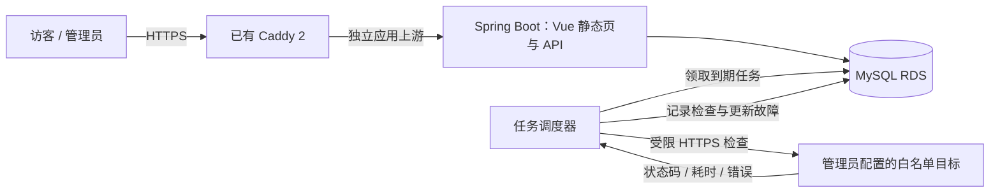

# PulseOps

**把服务状态、检查记录和故障处理过程放在同一处。**

PulseOps 是使用 Java 与 Vue 开发的服务巡检平台：定期检查经过授权的 HTTPS 目标，把真实检查结果展示在公开状态页，并提供监控配置、故障备注和操作审计后台。项目面向个人开发者与小型团队，使用一台 ECS 和 MySQL RDS 部署。

> 当前阶段：实现与本地验证已推进，正在部署。计划访问入口为 `pulse.ldjava.com`，尚未完成线上验收。仓库中的设计目标、验证计划和已验证结果分别记录，不把计划写成运行事实。

## 产品范围

- **公开状态页**：总体状态、服务列表、最近检查时间、24 小时检查成功率、平均探测耗时（包含失败探测）、检查历史和故障时间线。
- **监控管理**：管理员创建、编辑、暂停和恢复目标，触发立即检查；探测间隔至少 30 秒。
- **故障管理**：连续两次失败后创建故障，连续两次成功后恢复；管理员可添加公开进展备注。
- **安全与运维**：会话登录、CSRF 校验、主机白名单、出站请求限制、操作审计、数据库迁移和健康检查。

页面中的检查成功率来自已完成的探测样本，**不等同于合同意义上的 SLA 可用性**。没有数据时展示待检查或暂无数据。探测器与应用部署在同一台 ECS，整机故障会让探测一起停止。

## 技术结构

- 后端：Java 21、Spring Boot、JDBC、Flyway。
- 前端：Vue 3、TypeScript、Vite。
- 数据：MySQL；生产使用已有 RDS。
- 运行：复用 ECS 上已有的 Caddy 2 作为 HTTPS 入口，Java 应用提供内嵌 Vue 静态文件与 API。



## 目录

```text
backend/           Java API、调度器、数据库迁移和后端测试
frontend/          Vue 状态页与管理员界面
deploy/            低内存服务模板、打包、安装、更新与回滚工具
docs/              立项、架构、验收和面试说明
API-CONTRACT.md    前后端接口约定
```

## 配置

密钥通过运行环境提供，不提交到仓库。以下为接口合同确定的主要配置键；实际默认值和启动命令以模块实现为准。

| 配置 | 用途 |
|---|---|
| `DB_URL` | MySQL JDBC 连接地址 |
| `DB_USERNAME` / `DB_PASSWORD` | 数据库账户与密码 |
| `PULSE_ADMIN_USERNAME` / `PULSE_ADMIN_PASSWORD` | 管理员账户；用户名默认 `admin`，密码必须配置且至少 12 位 |
| `PULSE_ALLOWED_HOSTS` | 逗号分隔的精确主机白名单；仅支持 HTTPS 443 |
| `PULSE_SEED_TARGETS` | 逗号分隔的初始 HTTPS URL；仅在监控表为空时导入 |
| `PULSE_SECURE_COOKIE` | HTTPS 生产环境的 Secure Cookie 开关 |
| `PULSE_TRUSTED_PROXIES` | 可信代理的精确来源 IP；代理必须覆盖 X-Real-IP |
| `PULSE_ICP_NUMBER` | 网站展示的真实备案号 |
| `PULSE_RETENTION_DAYS` | 检查数据保留天数，默认 30，允许 1–90 |
| `PULSE_MONITOR_LIMIT` | 监控数量上限，默认 30，允许 1–100 |
| `PULSE_SCHEDULER_ENABLED` | 是否启用周期调度，默认 `true` |
| `SERVER_PORT` / `SERVER_ADDRESS` | 本地默认 `127.0.0.1:8080`；生产使用独立 18080；`PORT` 为兼容回退变量 |

不要把数据库密码、管理员密码、云账户凭证或包含凭证的连接串放入 Git。公开接口不展示监控 URL 中的查询参数或认证信息。

## 开发与验证

需要 Java 21、Maven，以及 Node.js 22.12 或更高兼容版本和 npm（当前 Vite 依赖声明为 `^20.19.0 || >=22.12.0`）。前后端按 [API 合同](API-CONTRACT.md) 实现。以下命令对应当前配置；实际执行结果记录在验收文档中。

在仓库根目录打开 PowerShell，启动后端：

```powershell
Set-Location backend
$env:PULSE_ADMIN_PASSWORD = [System.Net.NetworkCredential]::new('', (Read-Host '本地管理员密码，至少12位' -AsSecureString)).Password
$env:PULSE_SECURE_COOKIE = 'false'
mvn spring-boot:run
```

不提供 `DB_URL` 时使用本地文件 H2（MySQL 兼容模式），便于开发；生产环境显式配置 MySQL RDS。未配置白名单和初始目标时允许展示空状态。`PULSE_SECURE_COOKIE=false` 仅用于本地 HTTP 开发；HTTPS 生产环境使用 `true`。

另开终端，从仓库根目录启动前端：

```powershell
Set-Location frontend
npm ci
npm run dev
```

打开终端输出的 Vite 地址。开发代理把 `/api` 和 `/actuator` 转发到后端。公开入口是 `/`，管理员入口是 `/login`。

构建与测试：

```powershell
mvn -f backend/pom.xml clean verify
npm --prefix frontend run build
```

前端 `build` 同时执行 TypeScript 检查和 Vite 构建。部署包应先构建前端，再执行 Maven 打包并核验 JAR 内的静态文件。部署说明见 [部署工具与 Caddy 接入](deploy/README.md)，不能将本地开发服务器直接当作生产服务。

上线验收至少包含：从公网访问真实域名、管理员登录与修改配置、RDS 数据持久化、真实检查结果写入、两次失败与两次成功的状态变化、鉴权与 SSRF 拒绝场景、进程重启恢复。详细用例见 [验收方案](docs/03-acceptance.md)。

## 项目文档

- [立项与范围](docs/01-project-plan.md)：为什么选择这个项目，以及本次交付边界。
- [架构与关键设计](docs/02-architecture.md)：数据流、故障状态机、任务领取与安全限制。
- [验收方案与证据](docs/03-acceptance.md)：测试用例、上线门槛和真实验证记录。
- [简历与面试素材](docs/04-resume-and-interview.md)：可依据项目证据说明的技术取舍。

本项目尚未进行容量测试，不声明 QPS、并发上限或生产可用性指标。单节点部署的限制与后续演进方向见架构文档。
