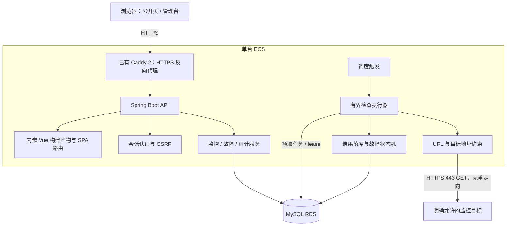
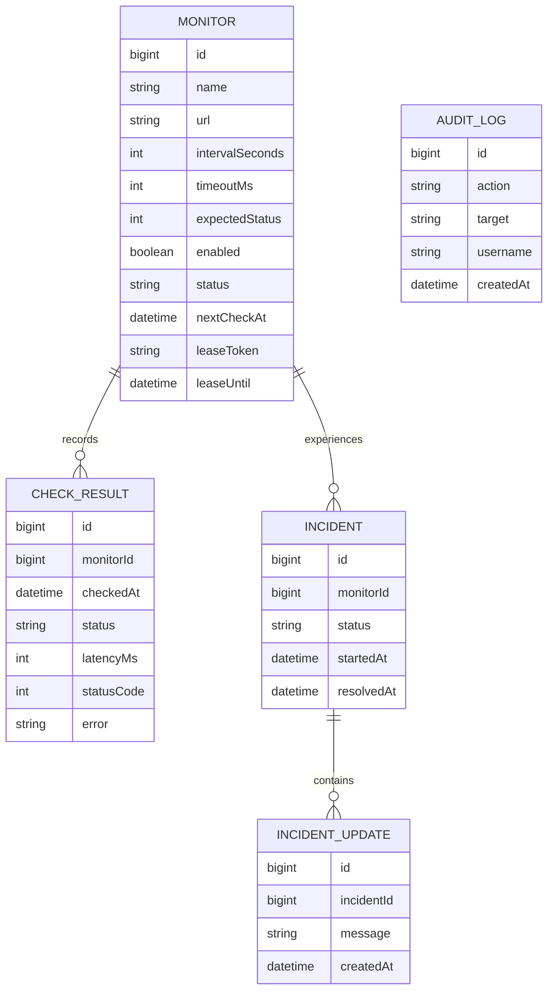
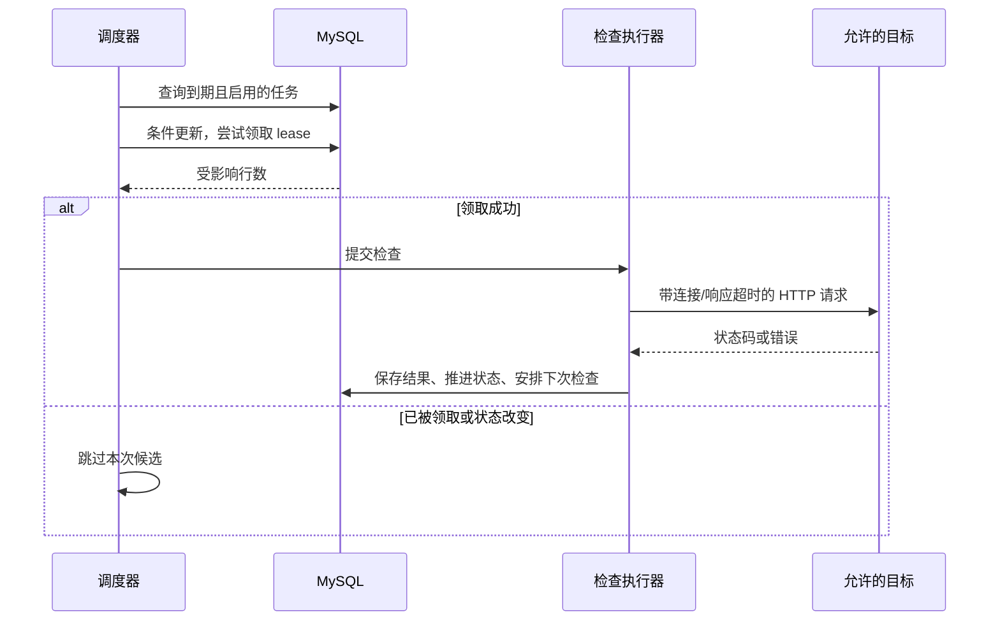
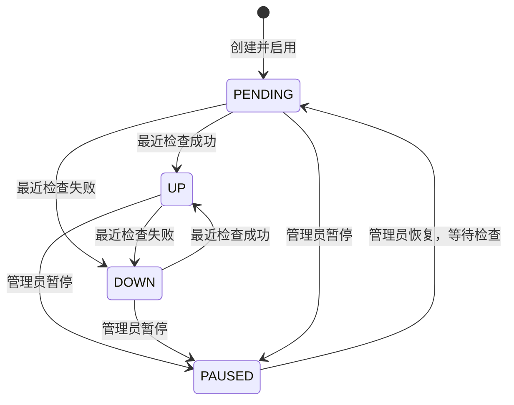
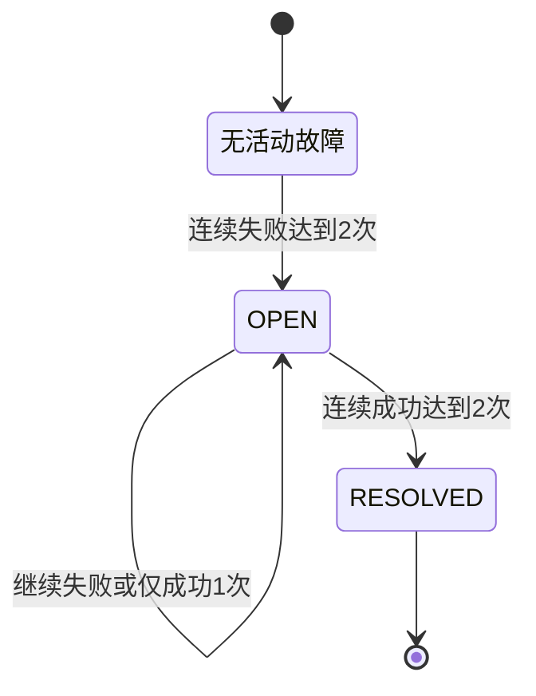

# PulseOps 架构与关键设计

状态：本文按 [API 合同](../API-CONTRACT.md) 与当前源码描述架构；构建、测试和线上验收结论分别记录在 [验收文档](03-acceptance.md)。代码中已实现不等于已经通过全部运行场景验证。

## 1. 部署与数据流



浏览器与 API 使用同源入口，降低部署与 Cookie 配置复杂度。RDS 保存配置、结果、故障和审计记录。系统没有为了单机 MVP 引入 Redis、消息队列或容器编排系统。

实际部署计划使用宿主 systemd 将应用绑定到 Docker bridge gateway `172.19.0.1:18080`，现有 Caddy 容器 `172.19.0.5` 转发请求。服务单元通过 `Wants=docker.service` 和 `After=docker.service` 将应用启动排在 Docker 之后，避免正常开机时先绑定尚未出现的 bridge 地址；该配置不修改现有 Docker 服务。

Flyway 管理数据库结构演进。生产数据库连接和管理员凭证来自环境配置。本地未配置数据库时使用文件 H2，生产显式连接 MySQL RDS。管理员来自启动配置，密码在运行时使用 BCrypt 编码，没有可供使用的默认密码；本次没有用户注册或用户表。实际表名、列类型与索引以数据库迁移为准，本文描述逻辑职责。

## 2. 逻辑数据模型



实际业务表为 `monitors`、`monitor_checks`、`incidents`、`incident_updates` 与 `audit_log`，另有 `application_locks` 协调监控数量上限检查。`monitor_checks(monitor_id, checked_at)` 支持单监控历史查询，`monitor_checks(checked_at)` 支持时间范围统计与保留清理；`monitors(enabled, next_check_at)` 支持到期查询。

审计记录描述管理动作；检查记录描述探测结果；故障及更新描述持续事件。这三类记录有不同用途，不能用一张通用日志表代替各自的查询与状态规则。本次直接查询原始样本计算 24 小时指标，没有实现日聚合表。

查询故障与更新时，先物化故障列表并释放查询占用，再读取更新记录；不在 `RowMapper` 持有结果集时嵌套借用另一个数据库连接。已有连接池上限为 1 的回归用例覆盖这一边界；这是资源使用正确性检查，不是吞吐测试。生产连接池保持 4。

## 3. 调度、lease 与并发

检查包含网络等待，不能在数据库事务中持续持有行锁。设计采用“短事务领取 → 事务外探测 → 短事务提交结果”的流程。



当前实现的 lease 与调度语义如下：

- 调度器每两秒查询到期任务。条件 `UPDATE` 同时检查启用、到期与旧 lease 是否过期，成功后写入 UUID token 和 45 秒有效期。
- 检查池最多四个线程，使用零排队的 `SynchronousQueue`；容量不足时释放本次 token，任务等待后续调度。
- 探测完成后，在事务中 `SELECT ... FOR UPDATE` 读取监控行，校验当前 token 和启用状态，再保存结果、更新故障与安排下次检查。
- 修改配置或启停会清除旧 token 并重置连续计数；进行中的旧检查即使返回，也不能使用已失效 token 写入结果。
- 下次计划时间为完成时刻加配置间隔，因此采用完成后的固定等待间隔，不承诺严格按整分钟刻度采样。
- 进程退出后，数据库中的 lease 最迟过期后可重新领取。释放动作也检查 token，避免旧执行者误释放新任务。
- 手动立即检查将下次计划时间提前并返回 `202`，仍经过同一调度流程。在已有检查进行中时可能与该次检查合并；返回值不保证额外生成一条独立样本。
- lease 与 token 检查抑制过期任务提交，但探测本身仍可能因故障恢复而重复执行，不能宣称端到端 exactly-once。

本次部署与验收目标是单节点；上述机制不是多实例生产验证的替代品。

Spring 提供 `TaskScheduler` 与 `TaskExecutor` 抽象用于调度和执行任务；采用这些基础能力足以覆盖本次单节点运行边界。[Spring 官方调度文档](https://docs.spring.io/spring-framework/reference/integration/scheduling.html)

## 4. 检查结果与故障状态机

检查是否成功由请求是否在超时内完成、返回状态码是否等于期望值决定。有效 token 对应的每次结果都落库。**服务当前状态采用最近一次样本，故障事件采用连续样本阈值**，不能把二者混为一谈。



故障事件有独立状态机：



一次成功会中断连续失败，一次失败会中断连续成功；持续失败不会反复创建同一活动故障。故障开始时间采用触发创建的第二次失败检查时间，恢复时间采用第二次连续成功检查时间。因此首次失败时服务状态可以已是 DOWN，而故障尚未打开；恢复第一次成功时服务状态可以已是 UP，而故障仍保持 OPEN。

修改、暂停和恢复监控会重置状态到 PENDING 及连续计数，已存在的故障不会因此自动恢复。暂停时对外显示 PAUSED。管理员故障备注公开展示，长度最多 2,000 字符。暂停监控不代表目标恢复，也不能伪造成功检查。

## 5. 统计语义

`uptime24h` 是接口历史命名。界面与文档应称其为“24 小时检查成功率”：

```text
成功率 = 过去24小时成功检查数 / 过去24小时已完成检查总数 × 100%
```

没有样本时返回 `null`。成功率保留两位小数。`latencyMs` 表示真实总探测耗时：从检查开始计时，到收到 HTTP 状态行，或者因 DNS、连接、TLS、超时等原因失败返回，包含 DNS 解析、建连和 TLS 握手等已执行阶段；不表示完整响应体下载耗时。即使 DNS 在 42 ms 后失败，也会保留这 42 ms 的失败探测耗时，不能将它标为“有效响应”。

`avgLatencyMs` 是同一时间范围内全部已完成样本的平均探测耗时，包含失败与超时，四舍五入为整数毫秒；不是成功请求的平均响应耗时。页面统一使用“探测耗时，包含失败探测”的含义。单监控历史展示最近 90 个样本，详情检查列表最多 100 条。

该值不等于 SLA：探测是离散采样，缺失样本未直接代表某段时间的可用性。页面展示最后检查时间。启用目标若从未检查，或结果年龄超过 `max(检查间隔×3, 检查间隔+超时+30秒)`，对外状态降为 PENDING，避免旧 UP 持续被显示为正常；暂停仍显示 PAUSED。这不会自动生成成功或失败样本，也不会修改历史成功率。

总体状态只聚合启用监控的最近状态：没有活动目标或全部待检查时为 PENDING，全部 DOWN 为 OUTAGE，部分 DOWN 为 DEGRADED，全部 UP 为 OPERATIONAL；剩余包含待检查的情况为 PENDING。已暂停监控不参与总体状态判断；24 小时样本指标仍包含时间范围内已有样本。活动故障数量独立展示，不直接改变总体状态。

## 6. SSRF 与访问控制

允许用户让服务器请求一个 URL，会带来访问云元数据、内网服务或本机管理端口的风险。因此配置目标与执行请求都需要服务端约束。

- 仅管理员可以修改目标；公开访客不能直接提交探测 URL。
- 仅允许 HTTPS 443，拒绝含用户认证信息或 URL 片段的目标；不接受 IP 字面量和其他端口。
- 主机必须属于配置中的精确白名单，不能通过字符串后缀误匹配。
- 检查域名解析的所有地址，拒绝私网、回环、链路本地、云元数据等非公开目标；IPv4 与 IPv6 均需覆盖。
- 不自动跟随跳转，防止白名单域名把探测转向其他地址。
- 日志和公开输出不泄露认证信息、完整查询参数、凭证或内部错误细节。

**DNS 与实际连接**：当前 `SafeHttpProbe` 先解析并校验全部候选地址，再用其中一个已经验证的 IP 建立连接；TLS 仍使用原始域名配置 SNI 和证书主机名验证，HTTP Host 也使用原始域名，避免连接时再次解析。解析和连接阶段的这个约束应保留在后续重构中。[OWASP SSRF 防护指南](https://cheatsheetseries.owasp.org/cheatsheets/Server_Side_Request_Forgery_Prevention_Cheat_Sheet.html)

DNS 查询使用独立的四线程、零排队执行池；调用方通过限时等待把解析纳入同一个请求 deadline。连接、TLS 握手与状态行读取均使用剩余时间，独立 deadline 线程在总时间到达时关闭 socket。系统 DNS 调用不一定能被中断，因此阻塞解析最多占用这四个 daemon 线程，容量不足时检查失败；这一限制防止无限创建 DNS 工作线程。

管理员使用服务端会话，Cookie 设置 HttpOnly；HTTPS 生产环境启用 Secure。所有写请求要求 `X-CSRF-TOKEN`，前端先读取 `/api/auth/session` 并在登录/退出后刷新会话。未登录返回 `401`，没有权限或令牌不合法返回 `403`。公开 GET 不需要登录。

入口 Caddy 配置 32 KB 请求体上限，并覆盖 `X-Real-IP`。后端仅在直接连接方属于 `PULSE_TRUSTED_PROXIES` 精确 IP 集合时读取该头用于限流；其他来源不能通过伪造它切换计数桶。可信代理与非可信转发头场景已有单元测试，生产代理链路另行验收。

## 7. 运行与演进边界

- 单台 ECS 无法在自身完全断电或断网时继续探测；独立探测点属于后续演进。
- 数据库不可达时无法持久化新结果，应在运维层识别；不能使用内存假数据维持正常展示。
- 原始检查记录默认保留 30 天，审计默认保留 90 天，每小时清理一次；故障与进展不随样本清理。若检查规模增长，可在有查询证据后增加日聚合、归档或分区。
- lease 让任务恢复与互斥更可控，但多实例部署还需要迟到结果保护、幂等、时钟与迁移协调等验证。
- 负载、吞吐、长期稳定性与容量上限均未验证，不以架构图作为性能保证。
